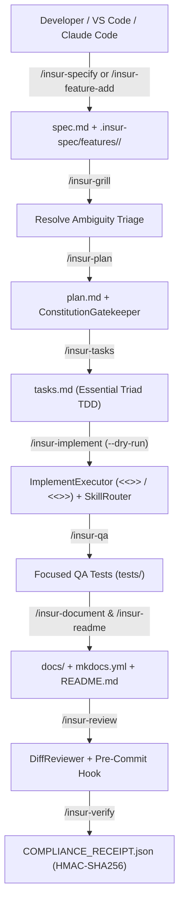

# InsurSpec 🛡️

**Sovereign Spec-Driven Coding Agent with Immutable Constitutional Governance, 26-Skill Insurance Factory, Brownfield Feature Registry, VS Code & Claude Code Slash Commands, MCP Server & Backstage.io Integration**

InsurSpec is an enterprise AI engineering platform designed for regulated insurance organizations operating across matrixed Line-of-Business (LOB) domains and shared services. It pairs a structured **Spec-Driven Development (SDD)** workflow with hard AST/regex compliance gates, targeted diff editing, dynamic skill routing, a pluggable Dual-LLM switchboard (**AWS Bedrock** + **Google Gemini**), and automatic **Backstage.io** service cataloging.

---

## Why InsurSpec?

Unconstrained AI coding assistants introduce "AI slop" (placeholder stubs, empty error handlers, vanity tests), destructive database migrations (`DROP TABLE`/`DROP COLUMN`), unmasked PII/PHI in logs, and uncataloged microservices. InsurSpec solves this by wrapping code generation in an **Immutable 10-Article Constitution**, a **5-Strike Circuit Breaker**, and **26 Insurance-Domain Skills**.

---

## Architecture Overview



### Core Components (`src/insur_spec/`)
- **`cli.py`**: Typer CLI orchestrating the full lifecycle (`init`, `specify`, `grill`, `plan`, `tasks`, `implement`, `qa`, `document`, `readme`, `quick`, `review`, `verify`), `feature` management, `skill` CRUD, `constitution`, and `mcp`.
- **`core/state_machine.py`**: `PhaseStateMachine` tracking workspace and per-feature phases in `.insur-spec/state.json`.
- **`core/feature_registry.py`**: `FeatureRegistry` managing incremental brownfield features under `.insur-spec/features/<NNN-slug>/`, appending to `## Feature Delta Log` in root `spec.md`, and generating a Python AST symbol map (`class`/`def` signatures) for brownfield context.
- **`core/constitution_checker.py`**: `ConstitutionGatekeeper` auditing plans and generated files against the 10-Article Constitution and Backstage `catalog-info.yaml`.
- **`core/executor.py` & `core/circuit_breaker.py`**: `ImplementExecutor` applying full `<<<FILE: ...>>>` and targeted `<<<EDIT: ...>>>` (`<<<SEARCH>>>` / `<<<REPLACE>>>`) blocks with `--dry-run` unified diff previews, Constitutional pre-write checks, and 5-strike circuit breaking (with log slicing $\le 100$ lines).
- **`core/reviewer.py`**: `DiffReviewer` auditing `git diff` against the 10-Article Constitution, PII/PHI rules, and hardcoded secret patterns.
- **`core/audit_signer.py`**: `AuditSigner` emitting HMAC-SHA256 signed `COMPLIANCE_RECEIPT.json` artifacts.
- **`llm/switchboard.py`**: `LLMSwitchboard` routing between **Google Gemini** (`gemini-3.8-flash` for local/dev) and **AWS Bedrock** (`anthropic.claude-3-5-sonnet-20241022-v2:0` for VPC production), with streaming (`--stream`) and offline mock fallback when API keys are unset.
- **`skills/manager.py`, `skills/loader.py` & `skills/router.py`**: `SkillsManager` (CRUD + Constitutional Inviolability Gate), `SkillsLoader` (prompt injection), and `SkillRouter` (dynamic skill selection from `spec.md`).
- **`mcp_server.py`**: Zero-dependency `stdio` JSON-RPC 2.0 MCP server exposing `tools/*`, `resources/*` (`insurspec://constitution`, `spec`, `plan`, `config`), and `prompts/*`.

For deeper component details, see [docs/ARCHITECTURE.md](docs/ARCHITECTURE.md).

---

## Quickstart

### 1. Install InsurSpec
```powershell
git clone https://github.com/K-J-Web-Designs/InsurSpec.git
cd InsurSpec
python -m venv .venv
.\.venv\Scripts\Activate.ps1   # On macOS/Linux: source .venv/bin/activate
pip install -e ".[all]"
```

### 2. Initialize a New Insurance Microservice Repo
```powershell
mkdir my-claims-service
cd my-claims-service
insur-spec init --name fnol-intake --lob pnc --domain claims --provider gemini
```

`insur-spec init` automatically scaffolds:
- `.insur-spec/config.yaml`, `.insur-spec/state.json`, `.insur-spec/memory/constitution.md`, `.insur-spec/skills/`
- **Backstage.io**: `catalog-info.yaml`, `mkdocs.yml`, `docs/index.md`
- **VS Code**: `.vscode/tasks.json`, `.vscode/mcp.json`, `AGENTS.md`, `.github/copilot-instructions.md`, and 19 `.github/prompts/*.prompt.md` slash commands
- **Claude Code & Git Hooks**: `CLAUDE.md`, `.claude/commands/insur-*.md`, `.claude/settings.json`, and `.git/hooks/pre-commit` (when `.git/` is present)

### 3. Run the Spec-Driven Workflow (v1)
```powershell
insur-spec specify "Ingest FNOL auto claims with PII masking and temporal lookup" --stream
insur-spec grill                       # Resolve any Ambiguity Triage items interactively
insur-spec plan --stream
insur-spec tasks
insur-spec implement --dry-run         # Preview unified diffs first
insur-spec implement --verify-cmd "pytest"
insur-spec qa --verify-cmd "pytest"
insur-spec document
insur-spec readme
insur-spec review                      # Audit git diff before PR
insur-spec verify
```

### 4. Fast-Track Mode (Small Fixes)
```powershell
insur-spec quick "Validate policy effective_date before FNOL intake" --verify-cmd "pytest"
```

---

## Incremental Brownfield Workflow (One Feature at a Time)

After v1 is built, you can add new features one at a time **without overwriting** your root `spec.md`:

```powershell
# 1. Add a new incremental feature (creates .insur-spec/features/002-.../ and appends to root spec.md)
insur-spec specify --add "Add subrogation recovery workflow with bi-temporal ledger tracking"

# 2. Run downstream steps (automatically targets the active feature and injects brownfield AST + spec context)
insur-spec grill
insur-spec plan
insur-spec tasks
insur-spec implement --verify-cmd "pytest"   # Auto-injects backward-compat-api-guard & expand-contract-db-migrator
insur-spec qa --verify-cmd "pytest"
insur-spec document
insur-spec review
insur-spec verify

# Inspect or switch between features at any time
insur-spec feature list
insur-spec feature use 002-add-subrogation-recovery-workflow
```

Root `spec.md` remains your **Living Master Specification**, with a `## Feature Delta Log` linking to each `.insur-spec/features/<NNN-slug>/spec.md`.

---

## VS Code & Claude Code Integration

### Slash Commands (`.github/prompts/*.prompt.md` & `.claude/commands/*.md`)
Type `/` in **VS Code Copilot Chat** or **Claude Code** in any initialized workspace to see all 19 InsurSpec commands with tooltips:

| Slash Command | Purpose |
| :--- | :--- |
| `/insur-specify` | Elicit v1 insurance feature requirements into `spec.md` |
| `/insur-feature-add` | Add an incremental brownfield feature (`--add`) preserving root `spec.md` |
| `/insur-grill` | Resolve Ambiguity Triage questions interactively before planning |
| `/insur-plan` | Generate technical architecture `plan.md` and run Constitution Check |
| `/insur-tasks` | Deconstruct `plan.md` into atomic Essential Triad TDD tasks |
| `/insur-implement` | Implement `tasks.md` using auto-routed domain skills and 5-Strike Breaker |
| `/insur-qa` | Generate Essential Triad QA tests (Happy Path, Key Boundary, Failure) |
| `/insur-document` | Generate Backstage TechDocs in `docs/` (`architecture.md`, `api_reference.md`, `data_model.md`) |
| `/insur-readme` | Generate or update a comprehensive root `README.md` |
| `/insur-review` | Audit git diff against Constitution, PII/PHI, and secret hygiene |
| `/insur-quick` | Fast-track small fix with mini-spec, targeted edit, and Constitution gate |
| `/insur-analyze-repo` | Deep-dive legacy repo discovery, architecture docs, PII map, and baseline spec |
| `/insur-refactor-plan` | Elicit refactoring goals and generate non-breaking Expand-Contract plan |
| `/insur-characterize` | Generate golden-master characterization tests before refactoring legacy code |
| `/insur-impact` | Analyze cross-team blast radius across APIs, schemas, and Backstage entities |
| `/insur-audit-legacy` | Run non-blocking Constitution & secret baseline scan (`docs/LEGACY_AUDIT.md`) |
| `/insur-onboard` | Generate a Day-1 Engineer Onboarding Guide (`docs/ONBOARDING.md`) |
| `/insur-incident-rca` | Triage a production stack trace or DLQ event and propose a safe fix |
| `/insur-verify` | Run final Constitution Gate and sign `COMPLIANCE_RECEIPT.json` |

### VS Code Tasks & MCP Server
- **Tasks (`Ctrl+Shift+P` → `Tasks: Run Task`)**: Pre-configured tasks in `.vscode/tasks.json` for every lifecycle command, skill listing, skill creation, and Constitution viewing.
- **MCP Server (`.vscode/mcp.json`)**:
  - **Tools**: `insur_spec_audit_plan`, `insur_spec_feature_list`, `insur_spec_skill_list`, `insur_spec_skill_get`, `insur_spec_verify`, `insur_spec_constitution`, `insur_spec_analyze_repo`, `insur_spec_audit_legacy`
  - **Resources**: `insurspec://constitution`, `insurspec://spec`, `insurspec://plan`, `insurspec://config`
  - **Prompts**: All 19 `/insur-*` workflows via `prompts/list` & `prompts/get`

---

## The 10-Article Insurance Constitution (`templates/constitution.md`)

1. **Article I — Anti-Slop Safeguards**: Blocks `// TODO`, `NotImplementedError`, truncating ellipses (`// ...rest of`), and unnecessary dependencies.
2. **Article II — Architecture & Resilience**: Enforces codebase discovery first and prohibits silent error swallowing (`except: pass`, empty `catch {}`).
3. **Article III — Focused Testing (Essential Triad)**: Prohibits vanity tests; enforces *Happy Path*, *Key Boundary*, and *Expected Failure* with parameterized tests.
4. **Article IV — Data Preservation**: Blocks `DROP TABLE`, `DROP COLUMN`, `TRUNCATE`, and unbounded `DELETE FROM`; mandates **Expand-Contract** migrations.
5. **Article V — Universal Cross-Device Sync**: Flags un-synced client-only data silos (`localStorage.setItem('user_...')`).
6. **Article VI — Security & Secrets**: Prohibits hardcoded secrets and unmasked PII/PHI logging.
7. **Article VII — Ambiguity Gate**: Requires pausing with 2–3 concrete options when requirements are under-specified.
8. **Article VIII — 5-Strike Circuit Breaker**: Halts repeated failure loops on strike 5 and truncates logs to $\le 100$ lines.
9. **Article IX — Spec-Before-Code**: Enforces `spec.md` → `plan.md` (with `## Mandatory Constitution Check`) → `tasks.md` → implementation.
10. **Article X — Backstage.io Cataloging**: Requires `catalog-info.yaml`, `mkdocs.yml`, and `docs/` synchronization.

---

## 26-Skill Enterprise Insurance Factory (`skills_factory/`)

Inspect any skill with `insur-spec skill get <name>`, or add custom project skills with `insur-spec skill add <name>` (validated against the Constitution so no skill can relax compliance rules):

- **Core Insurance Domains**: `fnol-claims-intake`, `policy-lifecycle-engine`, `rating-algorithm-transpiler`, `actuarial-model-wrapper`, `reinsurance-treaty-allocator`, `insurance-fraud-signal-mesh`
- **Legacy, EDI & PAS Integration**: `acord-standard-parser`, `edifact-x12-translator`, `mainframe-copybook-parser`, `pas-adapter-generator`
- **Data, APIs & Resilience**: `expand-contract-db-migrator`, `temporal-data-versioning`, `backward-compat-api-guard`, `idempotent-event-consumer`, `dead-letter-circuit-breaker`, `saga-orchestration-builder`
- **Security, Compliance & Governance**: `phi-pii-token-masker`, `sox-glba-control-enforcer`, `static-secret-scanner`, `audit-trail-lineage`, `state-filing-doc-synthesizer`, `adr-architectural-decision`, `backstage-techdocs-cataloger`
- **Testing & Quality**: `test-triad-generator`, `contract-test-pact-author`, `sonarqube-quality-gate-pass`

---

## LLM Provider Configuration

- **Offline / Mock Mode**: Runs out-of-the-box with zero API keys for `init`, `constitution`, `skill *`, `feature *`, `review`, `mcp`, `pytest`, and template-based lifecycle testing.
- **Google Gemini (Dev / Sandbox)**: Set `$env:GEMINI_API_KEY = "<your-key>"` (or `GOOGLE_API_KEY`) and use `--provider gemini`.
- **AWS Bedrock (Enterprise VPC Production)**: Configure `AWS_ACCESS_KEY_ID` / `AWS_PROFILE` / `AWS_ROLE_ARN` + `AWS_REGION` and use `--provider bedrock` (or `INSURSPEC_LLM_PROVIDER=bedrock`).

---

## Docker Packaging (Enterprise VPC Delivery)

```bash
docker build -t insur-spec:0.1.0 .
docker run --rm -v "$(pwd):/workspace" -e INSURSPEC_LLM_PROVIDER=bedrock insur-spec:0.1.0 verify
```

---

## Running Tests

```powershell
pytest tests/ -v
```
