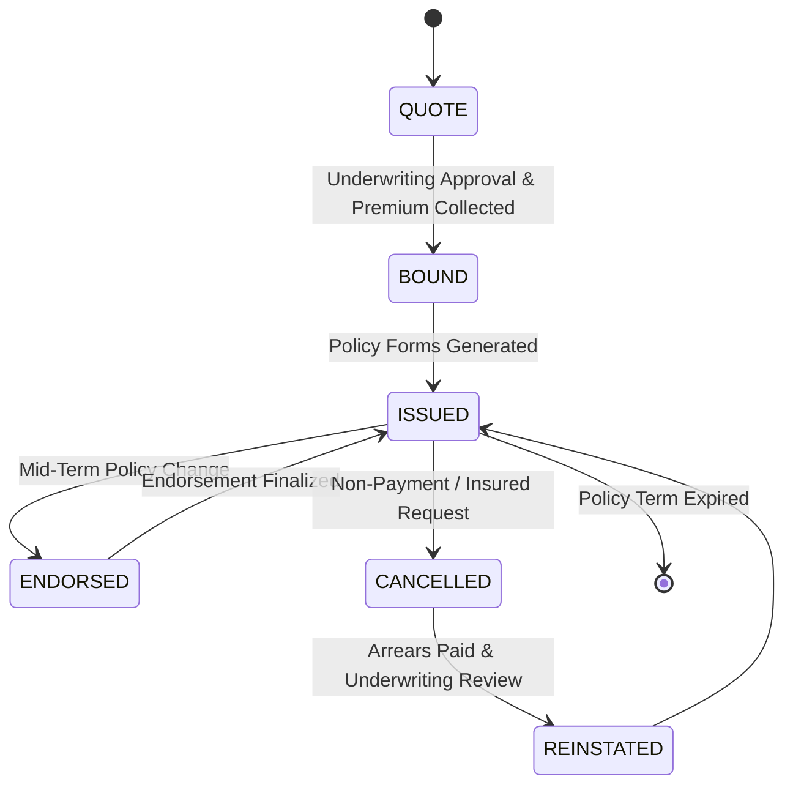

# Policy Lifecycle Engine Skill

This skill enforces valid, compliant state transitions for insurance policies.

---

## 1. The Canonical Policy State Machine

---

## 2. Invariant Rules

- Never transition from `QUOTE` directly to `ISSUED` without entering `BOUND`.
- Never endorse a `CANCELLED` policy without first completing formal reinstatement.
- Every state transition MUST emit a non-repudiable audit event to the enterprise event mesh.
