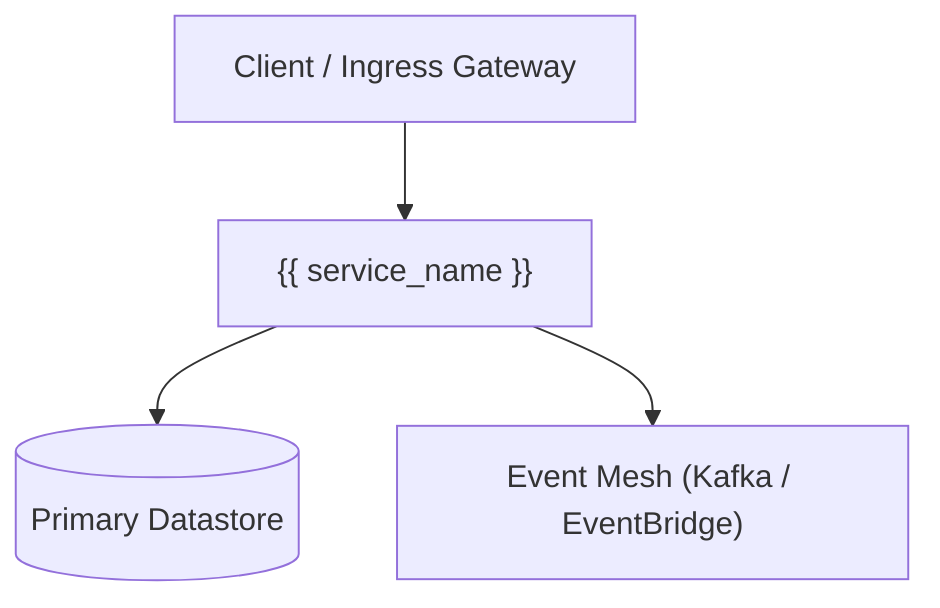

# Technical Architecture Plan: {{ feature_title }}

## 1. System Context & C4 Component Model

## 2. Data Persistence & Non-Destructive Migrations
- **Expand-Contract Strategy**:
  - Additive changes:
  - Backfill routine:
  - Deprecation timeline:

## 3. API Contract & Backstage Catalog Updates
- **Exposed Endpoints**:
- **Backstage `catalog-info.yaml` Changes**:
- **TechDocs Updates**:

## 4. Focused Testing Strategy (The Essential Triad)
- **Happy Path**:
- **Key Boundary / Edge Case**:
- **Expected Failure**:

## 5. Mandatory Constitution Check
- [ ] No stubs, placeholders, or empty catch blocks (Article I).
- [ ] No unnecessary third-party dependencies introduced (Article I).
- [ ] Existing project utilities and conventions reused (Article II).
- [ ] Tests are focused: zero vanity tests, essential triad respected, parameterized where possible (Article III).
- [ ] Existing data protected: zero destructive resets, non-destructive schema migrations only (Article IV).
- [ ] Cross-device sync guaranteed: state is user-scoped, cloud-backed, and auto-syncing across all client instances (Article V).
- [ ] Secrets and credential security respected (Article VI).
- [ ] All requirements clarified; zero unverified business assumptions (Article VII).
- [ ] Execution loop budget and token-efficient test runners identified (Article VIII).
- [ ] Backstage catalog entity and TechDocs synchronized (Article X).
